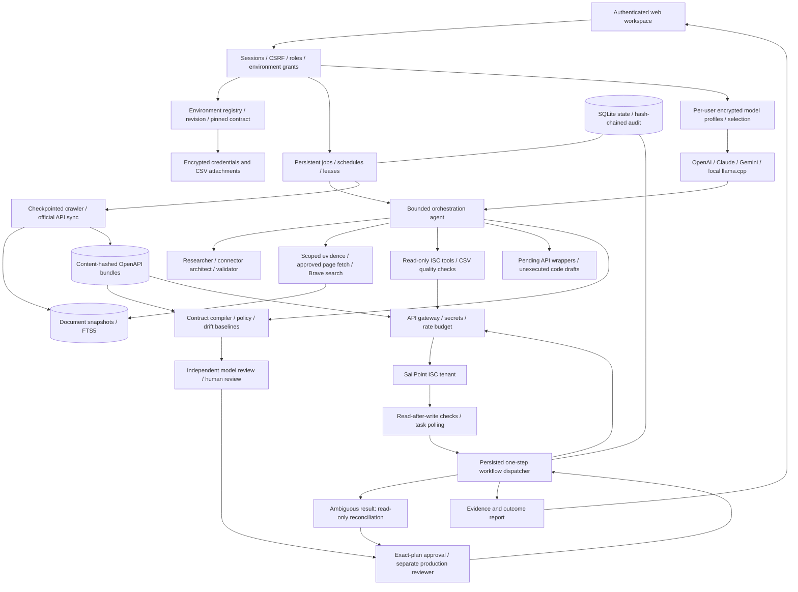
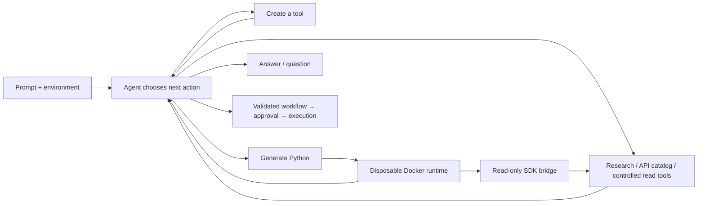

# Implemented architecture: v0.3

## Authority and execution

Agents propose, authenticated users authorize, and the dispatcher executes. Models
receive no credentials, arbitrary HTTP, shell access or permission-management tools.
Specialists are logical agents with independent contexts, not distributed services.
All share a bounded budget. Generated API tools wrap documented operations and cannot
expand permissions. Python drafts remain unexecuted.

Retrieved text is untrusted. Prompt instructions help the model distinguish evidence
from policy, but are not a security boundary. Schema checks, role permissions,
environment grants and exact-plan approval remain enforced outside the model.

Remote execution persists `sending` before transmission. A crash before transmission
and a crash after remote acceptance can be indistinguishable; both therefore require
reconciliation rather than replay. This is not a distributed exactly-once guarantee.
Current workflows are serial and capped at twenty operations. SQLite is intended for
a single-server deployment, not a highly available distributed service.

Baseline checks cannot prevent all external races when an API lacks concurrency
controls. A successful HTTP call is not proof of correct identity correlation or
provisioning. The quality of expected-value assertions remains an engineering concern.

## Verified versus unverified

- Verified using SailPoint’s real public repository: unified ISC OpenAPI download
  and import of 993 operations, with resource-versioned paths preserved. Legacy
  year-versioned snapshots remain supported for already-pinned environments.
- Verified with synthetic HTTP transports: OAuth construction, paths, schemas,
  source creation, drift, polling, ambiguous writes, reconciliation, compression,
  multipart forms and CSV quality checks.
- Verified through TestClient: authentication, CSRF, access grants, environment setup,
  simulation planning, approval and queued execution.
- Provider adapters are verified with protocol fixtures, including keyless local
  planning, profile ownership, queued-model pinning and preservation of existing
  environment records. Local and cloud models use the same validation and authority gates.
- Light/dark/system preference behavior is verified with a simulated browser/OS event harness.
- Unverified against live services here: actual model reasoning, Brave search, product-docs
  crawling, and customer tenant operations. Credentials were not supplied and the
  configured runtime egress does not include those destinations.
- Browser automation was unavailable. HTML serving and JavaScript syntax were checked;
  responsive visual and interactive browser QA remains a deployment validation task.

## Production readiness boundary

1. Validate one real sandbox connector: prerequisites, capabilities, aggregation,
   positive/negative correlation, identity mappings and lifecycle/provisioning cases.
2. Evaluate actual model plans against approved regression scenarios. Measure correct
   API selection, missing-decision detection, evidence usefulness, unsafe-request
   rejection, human corrections, outcomes, latency and cost.
3. Integrate SSO/MFA, managed keys/secrets, rotation and account recovery. Local session
   authentication is not organization SSO.
4. Add independent immutable audit, encrypted backups, restore drills, monitoring,
   provider spend limits and distributed coordination where required.
5. Add proven connector recipes, additional content types, semantic retrieval and
   generated-code dependency profiles, stronger multi-tenant isolation, and connector deployment validation for concrete use cases.

These operational and business validations cannot be inferred from local contract tests.

## Unified agent loop and Python runtime

Natural-language requests always reach `Orchestrator`; no keyword router selects a
business API or fixed procedure. The model chooses capabilities and returns an answer,
a clarification, or a workflow. API discovery happens when the agent calls `catalog`.
Read API wrappers created with `create_tool` can be used immediately; write wrappers
stay pending review. Agents can execute Python through `run_python`.

Python receives source and JSON inputs through stdin, not host mounts. Docker has a
read-only root, non-root UID, no network, no added capabilities, memory/CPU/PID limits,
and bounded time/output/tool calls. The SDK cannot execute write operations, approve
plans, spawn recursive code runners, or obtain credentials. Execution results and
answers are encrypted and environment-scoped. The runtime never executes generated
code inside the server process. See [runtime setup](agent-runtime.md).
